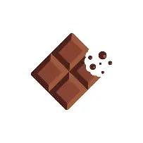
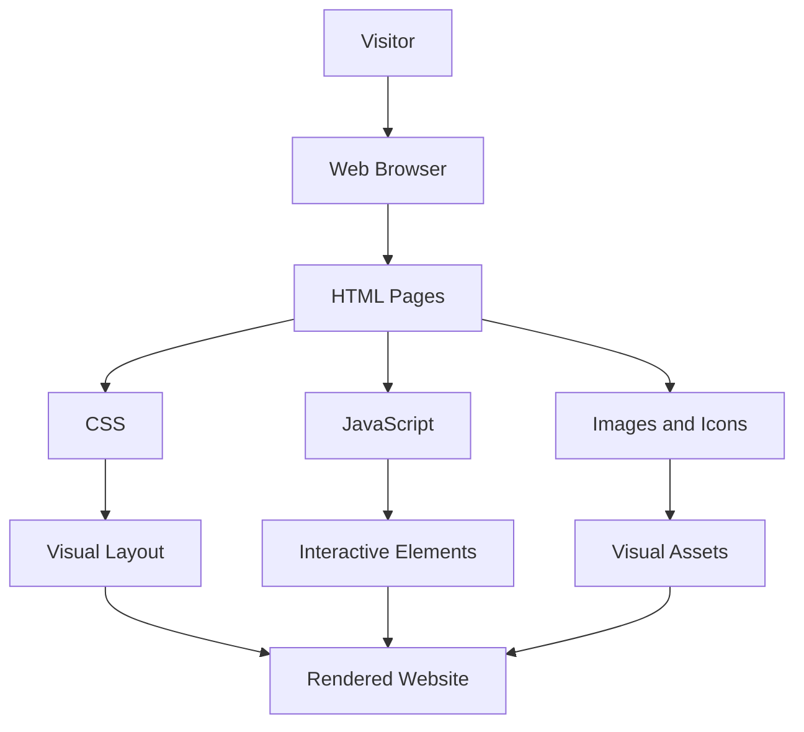
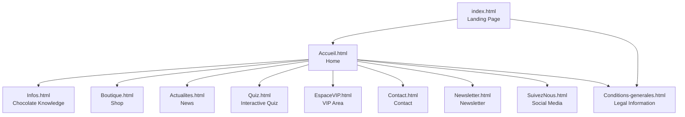

 <div align="center">




# CHOCOCOA WEB

### A little world of cocoa, chocolate and interactive experiences.

A multi-page chocolate-themed website built with **HTML5, CSS3 and vanilla JavaScript**.

<br/>

[](https://github.com/RufusTheDwarf/chococoa-web/stargazers)
[](https://github.com/RufusTheDwarf/chococoa-web/forks)
[](https://github.com/RufusTheDwarf/chococoa-web/issues)
[](https://github.com/RufusTheDwarf/chococoa-web/commits/main)

<br/>

[](https://developer.mozilla.org/en-US/docs/Web/HTML)
[](https://developer.mozilla.org/en-US/docs/Web/CSS)
[](https://developer.mozilla.org/en-US/docs/Web/JavaScript)
[](https://developer.mozilla.org/en-US/docs/Web/JavaScript)
[](#project-architecture)

<br/>

[Explore the project](#project-overview) · [Discover the pages](#website-pages) · [Installation](#getting-started)

</div>

---

## Table of Contents

- [Project Overview](#project-overview)
- [Visual Gallery](#visual-gallery)
- [Website Pages](#website-pages)
- [Features](#features)
- [Project Architecture](#project-architecture)
- [Navigation Map](#navigation-map)
- [Technology Stack](#technology-stack)
- [Design System](#design-system)
- [Project Structure](#project-structure)
- [Getting Started](#getting-started)
- [Project Notes](#project-notes)
- [Contributing](#contributing)
- [Credits](#credits)

---

## Project Overview

**Chococoa Web** is a chocolate-themed website designed around the world of cocoa and chocolate craftsmanship.

The project brings together a collection of interconnected pages covering chocolate products, educational content, news, interactive quizzes and customer-oriented sections.

The interface is written in French and uses a consistent visual identity based on warm chocolate colors, cream backgrounds, golden accents and animated elements.

The project was built with a simple web stack, without React, Vue or another front-end framework.

### Project at a glance

| Category | Details |
|:--|:--|
| Project | Chococoa Web |
| Type | Multi-page static website |
| Interface language | French |
| Main technologies | HTML, CSS, JavaScript |
| Styling | Custom CSS |
| Interactivity | Vanilla JavaScript |
| Main entry point | `index.html` |
| Development environment | Visual Studio Code |
| Educational context | ETML |

## Visual Gallery

A selection of the original visual assets included in the repository.

<div align="center">

<table>
<tr>
<td align="center" width="33%">

<br/>
<strong>Chocolate Assortments</strong>
<br/>
<sub>A selection of chocolate creations</sub>
</td>
<td align="center" width="33%">

<br/>
<strong>Chocolate Varieties</strong>
<br/>
<sub>Discover different chocolate styles</sub>
</td>
<td align="center" width="33%">

<br/>
<strong>Cocoa Inspiration</strong>
<br/>
<sub>Visual identity and atmosphere</sub>
</td>
</tr>
</table>

</div>

## Website Pages

The website is organized into several dedicated sections. Each page has its own purpose while sharing the same navigation and visual identity.

### Main experience

| Page | File | Description |
|:--|:--|:--|
| Landing Page | `index.html` | Main introduction to the chocolate universe |
| Home | `Accueil.html` | Main website page with offers and service navigation |
| Information | `Infos.html` | History, chocolate varieties and production |
| Boutique | `Boutique.html` | Product catalogue and order information |
| News | `Actualites.html` | Updates, collections and chocolate-related articles |

### Interactive and customer sections

| Page | File | Description |
|:--|:--|:--|
| Quiz | `Quiz.html` | Interactive quiz with four different themes |
| VIP Area | `EspaceVIP.html` | Exclusive content, tasting advice and recipes |
| Newsletter | `Newsletter.html` | Newsletter subscription interface |
| Contact | `Contact.html` | Contact details and message interface |
| Social Media | `SuivezNous.html` | Social platform presentation and gallery |
| Legal Information | `Conditions-generales.html` | Legal notices and privacy information |

### Additional deliverable

| Page | File | Description |
|:--|:--|:--|
| Project Deliverable | `livrable.html` | Dedicated project deliverable page |

## Features

### Chocolate Boutique

The boutique presents a collection of chocolate products and gift assortments.

Featured products include:

- Grand Cru 75% chocolate bar
- 12-piece tasting box
- Chocolate and orange truffles
- Chocolate and coffee bar
- Fairtrade collection
- Red fruit mendiants

The product pages include descriptions, ingredients or origins, and information about ordering and delivery.

### Chocolate Knowledge

The information section introduces visitors to the world of cocoa.

Topics include:

- The history of chocolate
- The origins of cocoa
- Dark, milk, white and ruby chocolate
- From cocoa bean to chocolate bar
- Sustainable and ethical cocoa
- Chocolate and well-being

### Interactive Quiz

The quiz is powered by a dedicated JavaScript module.

It contains four themes:

| Theme | Content |
|:--|:--|
| Origins | History and origins of chocolate |
| Flavours | Chocolate flavours and pairings |
| Benefits | Chocolate and its properties |
| Recipes | Chocolate and culinary knowledge |

The quiz includes multiple-choice questions, answer feedback, explanations and the option to restart or change the selected theme.

### VIP Experience

The VIP page contains additional editorial content, including:

- Exclusive recipe content
- The five senses of chocolate tasting
- Special offers
- Chocolate club presentation
- Gift guide
- Dedicated content library

### Customer Pages

The project also includes dedicated interfaces for contact and newsletter subscriptions.

These pages provide input fields and user-facing actions as part of the website experience.

## Project Architecture

Chococoa Web follows a simple static front-end architecture.

The browser loads the HTML pages, applies their CSS stylesheets and executes the JavaScript files needed for interactive behavior.



### JavaScript Modules

| File | Responsibility |
|:--|:--|
| `courseur.js` | Custom cursor behavior |
| `mouvement-de-page.js` | Mouse-based page movement effect |
| `quiz.js` | Quiz questions, themes and interactions |

### CSS Modules

| File | Responsibility |
|:--|:--|
| `global.css` | Shared layout, navigation, visual styles and animations |
| `quiz.css` | Quiz-specific styling |
| `livrable.css` | Deliverable page styling |

## Navigation Map

The website uses a shared navigation structure across its main pages.

The home page also provides links to the other sections, including the shop, news, contact and newsletter pages.



## Technology Stack

The project intentionally uses browser-native technologies.

<div align="center">

<table>
<tr>
<td align="center" width="33%">

<br/>
<strong>HTML5</strong>
<br/>
<sub>Page structure and content</sub>
</td>
<td align="center" width="33%">

<br/>
<strong>CSS3</strong>
<br/>
<sub>Layout, colors and animations</sub>
</td>
<td align="center" width="33%">

<br/>
<strong>JavaScript</strong>
<br/>
<sub>Interactive behavior</sub>
</td>
</tr>
</table>

</div>

| Tool | Purpose |
|:--|:--|
| Visual Studio Code | Code editor |
| Git | Version control |
| GitHub | Repository hosting |
| Google Fonts | Typography |
| Live Server | Local development server |

No package manager, build system or framework is required to run the website.

## Design System

The visual identity follows a cocoa-inspired palette.

### Color Palette

<div align="center">

<table>
<tr>
<td align="center" width="20%" bgcolor="#2C1810">
<strong style="color:#FFF4D6">Dark Cocoa</strong>
<br/>
<code>#2C1810</code>
</td>
<td align="center" width="20%" bgcolor="#4F2D00">
<strong style="color:#FFFFFF">Cocoa</strong>
<br/>
<code>#4F2D00</code>
</td>
<td align="center" width="20%" bgcolor="#6B4423">
<strong style="color:#FFFFFF">Chocolate</strong>
<br/>
<code>#6B4423</code>
</td>
<td align="center" width="20%" bgcolor="#A0622D">
<strong style="color:#FFFFFF">Caramel</strong>
<br/>
<code>#A0622D</code>
</td>
<td align="center" width="20%" bgcolor="#F7F1D2">
<strong style="color:#2C1810">Vanilla</strong>
<br/>
<code>#F7F1D2</code>
</td>
</tr>
</table>

</div>

### Visual Elements

- Chocolate-inspired navigation bar
- Animated decorative chocolate drips
- Floating chocolate elements
- Rounded navigation buttons
- Custom cursor
- Mouse-based movement effects
- Shared typography and page styling

The main styling is centralized in `css/global.css` to keep the different pages visually consistent.

## Project Structure

The repository is organized around HTML pages, shared stylesheets, JavaScript modules and local visual assets.

```text
chococoa-web/
│
├── index.html
├── Accueil.html
├── Infos.html
├── Boutique.html
├── Actualites.html
├── Quiz.html
├── EspaceVIP.html
├── Newsletter.html
├── Contact.html
├── SuivezNous.html
├── Conditions-generales.html
├── livrable.html
│
├── css/
│   ├── global.css
│   ├── quiz.css
│   └── livrable.css
│
├── js/
│   ├── courseur.js
│   ├── mouvement-de-page.js
│   └── quiz.js
│
├── images/
│   ├── faviconsiteweb.webp
│   ├── Plusieurs_chocolats.webp
│   ├── assortiments_de_chocolat.webp
│   ├── tourbillon_de_chocolat.webp
│   ├── other chocolate assets
│   └── icones/
│
├── icons/
│   ├── Facebook.jpg
│   ├── Instagram.png
│   ├── TikTok.webp
│   └── Youtube.jpg
│
└── README.md
```

## Getting Started

### Requirements

- Git
- A modern web browser
- Visual Studio Code (recommended)

### 1. Clone the repository

```bash
git clone https://github.com/RufusTheDwarf/chococoa-web.git
```

### 2. Enter the project directory

```bash
cd chococoa-web
```

### 3. Open the project

Open the folder in Visual Studio Code.

### 4. Start the website

Open `index.html` in your browser.

For a more convenient development environment, use the **Live Server** extension:

1. Open `index.html` in VS Code.
2. Right-click inside the file.
3. Select **Open with Live Server**.

The website will open in your browser.

## Project Notes

A few implementation details are worth keeping in mind:

- The repository contains a static front-end project. No server-side application or database is included.
- The contact and newsletter pages contain user interface fields, but no message delivery or mailing backend is included in the repository.
- The VIP area is a content section, not a complete authenticated account system.
- Social media cards are present, but their current links use placeholder destinations.
- `SuivezNous.html` currently references JavaScript through `./JS/`, while the tracked folder is named `js/`. On case-sensitive hosting, these paths should be corrected to `./js/`.

These notes distinguish the existing implementation from features that would require additional development.

## Contributing

Suggestions, improvements and bug reports are welcome.

To contribute:

1. Fork the repository.
2. Create a new branch.
3. Make your changes.
4. Commit your work.
5. Open a Pull Request.

Example:

```bash
git checkout -b feature/my-feature
git add .
git commit -m "Improve website section"
git push origin feature/my-feature
```

## Credits

**Created by [RufusTheDwarf](https://github.com/RufusTheDwarf)**

Project developed in the context of ETML.

Technologies and resources:

- HTML, CSS and JavaScript
- Google Fonts
- Devicon
- Shields.io
- Capsule Render
- GitHub

---

<div align="center">


### THANK YOU FOR VISITING

**CH O C O C O A  W E B**

*A little more chocolate in the digital world.*

<br/>

[](https://github.com/RufusTheDwarf/chococoa-web)
[](https://github.com/RufusTheDwarf)

<sub>Chococoa Web · ETML · 2026</sub>


</div>
